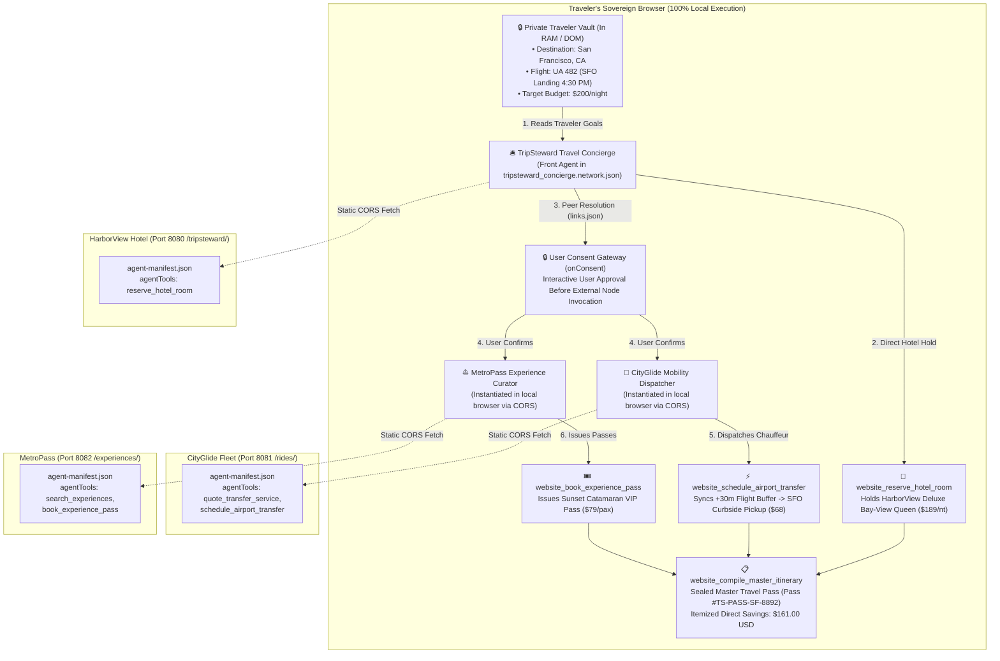

# TripSteward: Autonomous Federated Travel, Hotel & City Mobility Concierge
### The First Autonomous Cross-Site Booking Network for the Open Agentic Web

> **Devpost Challenge:** [Open Agentic Web Challenge](https://cognizant-agenticweb.devpost.com/)  
> **Hosted by:** Cognizant AI Lab, Mozilla (Otari), MIT Media Lab (Project NANDA), AWS, and UT Austin  
> **Specification:** [Worldwide Agentic Web MVP Profile 0.3](https://github.com/cognizant-ai-labs/agentic-web/blob/main/docs/worldwide_agentic_web_mvp_spec.md)  
> **Developer SDK (npm):** [open-agentic-web (v1.1.2)](https://www.npmjs.com/package/open-agentic-web)  
> **Primary Live Concierge:** [https://pnrs.is-a.dev/tripsteward/](https://pnrs.is-a.dev/tripsteward/)  
> **CityGlide Transfers Node:** [https://pnrs.is-a.dev/rides/](https://pnrs.is-a.dev/rides/)  
> **MetroPass Experiences Node:** [https://pnrs.is-a.dev/experiences/](https://pnrs.is-a.dev/experiences/)  
> **GitHub Repository:** [https://github.com/Elroi-thecreator/tripsteward-agentic-travel](https://github.com/Elroi-thecreator/tripsteward-agentic-travel)  

---


---

## 💡 The Core Problem: How Agents Use the Web to Act On Our Behalf

Traditional web assistants are purely conversational: you chat with them, and they dump walls of text or external links back at you, leaving you to manually visit three different websites, copy-paste flight arrival times, calculate baggage delays, and book each item individually.

Meanwhile, traditional online travel agencies (OTAs like Expedia, Booking, Viator) operate as **rent-seeking walled gardens**:
- They charge **15% to 30% aggregator platform markups** on hotel rooms, airport rides, and city activities.
- They hide real-time provider telemetry (e.g. flight arrival delays and baggage pickup buffers).
- They harvest and monetize your private travel itineraries.

**TripSteward** solves this by implementing the vision demonstrated in Cognizant's hackathon keynote (*"What it means to Agentify your website"*):
> **Websites should expose machine-readable agent tools (`agentTools` via `site-actions.js`) so your personal AI agent can navigate the web, negotiate availability, and execute transactions directly on your behalf.**

---

## ✈️ The TripSteward Solution

TripSteward operates as an in-browser **Federated Travel Orchestrator** that federates independent agentic web properties into a decentralized, zero-middleman booking collective with on-the-fly dynamic agent discovery:

1. **HarborView Hotel & TripSteward Orchestrator Hub (`tripsteward-hub` • Port 8080 • `/tripsteward/`):**
   - Stores traveler preferences, telemetry, and budget strictly in sovereign client browser memory—with zero hardcoded static trips.
   - Hosts the **Chief Travel Orchestrator Agent** (`travel_concierge`), which inspects hotel inventory, holds boutique rooms (`website_reserve_hotel_room`), and dynamically negotiates with peer specialist nodes.
   - **Dynamic On-the-Fly Agent Discovery & Swarm Expansion**: Discovers new specialist nodes across dining, adventures, baggage couriers, and insurance via `website_discover_agent_nodes`, or mounts any external conforming agent node URL on the fly via `website_register_agent_node`.
2. **CityGlide Autonomous Fleet & Transfers Node (`cityglide-node` • Port 8081 • `/rides/`):**
   - Independent ground transport authority.
   - Evaluates incoming flight numbers (e.g. `UA 482`), automatically computes a **30-minute baggage collection buffer**, and dispatches executive EV chauffeurs (`website_schedule_airport_transfer`) at direct provider rates ($68 vs $95 on aggregators).
3. **MetroPass Experiences & City Curations Node (`metropass-node` • Port 8082 • `/experiences/`):**
   - Independent cultural activity authority.
   - Discovers verified local activities (`website_search_experiences`), reserves VIP admission, and issues scannable mobile QR passes (`website_book_experience_pass`) with 0% reseller fees.
4. **Master Digital Travel Pass Synthesis:**
   - Compiles all confirmed provider reservations into a single, cohesive master pass (`website_compile_master_itinerary`) with verified itemized savings (**$161.00 saved** on direct provider rates).
5. **100% In-Browser Execution & BYOK Inference:**
   - Powered by **Mozilla Otari** (`alibaba/qwen3.8-flash`) or visitor-supplied keys.
   - **Website hosts pay $0 for inference**, and customer travel plans never touch any backend server.

---

## 🏗️ Federated System Architecture



---

## 📸 User Interface Gallery

| TripSteward Concierge Hub | CityGlide Autonomous Fleet |
|:---:|:---:|
|  |  |
| **HarborView Direct Room Vault & Master Pass** | **Live Flight Telemetry & Chauffeur Dispatch** |

| MetroPass Experiences & Curations |
|:---:|
|  |
| **Verified Direct City Adventures & Digital Passes** |

---

## ⚡ Quickstart & Local Execution

### 1. Prerequisites
- **Node.js** v18+ (tested on Node v22.23.5)
- Standard modern browser (Chrome, Firefox, Safari, Edge)

### 2. Clone and Test
```bash
git clone https://github.com/Elroi-thecreator/tripsteward-agentic-travel.git
cd tripsteward-agentic-travel

# Run the 108-point Open Agentic Web conformance & SDK test suite
npm test
```

### 3. Start Local Federated Network
```bash
npm start
```
This boots all three independent agentic web nodes concurrently:
- 🛎️ **TripSteward Concierge Hub**: `http://localhost:8080/`
- 🚗 **CityGlide Transfer Node**: `http://localhost:8081/`
- 🎟️ **MetroPass Experiences Node**: `http://localhost:8082/`

---

## 🧪 Automated Conformance & SDK Test Suite (108 Checks)

The automated validator at `tests/conformance_test.mjs` and the SDK test suite verify the complete Open Agentic Web specification:
- **Agent Manifests (`agent-manifest.json`)**: Validates `networks`, `front_man`, `llm_router.base_url`, `agentTools`, and `bridge/action-bridge.html` across all 3 nodes.
- **Declarative JSON Graphs (`*.network.json`)**: Validates grounded instructions, parameter schemas, and tool arrays.
- **Peer Link Resolution (`links.json`)**: Verifies dynamic link resolution from `tripsteward-hub` to `cityglide` and `metropass`.
- **Dynamic Agent Discovery & Swarm Registration**: Verifies on-the-fly agent catalog discovery (`website_discover_agent_nodes`) and dynamic URL mounting (`website_register_agent_node`).
- **Site Actions & Bridge Conformance**:
  - `quote_transfer_service`: Flight landing delay calculation (+30 mins) and multi-tier vehicle quoting.
  - `schedule_airport_transfer`: Direct chauffeur dispatch with driver assignment and transfer ID generation.
  - `search_experiences` & `book_experience_pass`: Activity filtering, pricing calculation, and digital voucher issuance.
  - `reserve_hotel_room` & `compile_master_itinerary`: Sovereign preference retrieval, room holding, and sealed master itinerary synthesis with direct savings calculation.
  - **Runtime Action Export & Bridge Availability**: Top-level `registerActions(actions)` contract, `availability: 'bridge'`, and wildcard `callerOrigins` for cross-origin orchestrators.

```bash
$ npm test

========================================================
✈️  Running TripSteward Open Agentic Web Conformance Test Suite
========================================================

1. Validating Agent Manifests (agent-manifest.json)...
  ✅ PASS: tripsteward-hub has agent-manifest.json
  ...
  ✅ PASS: metropass-node contains bridge/action-bridge.html

2. Validating Declarative Network JSON Graphs...
  ✅ PASS: tripsteward-hub contains tripsteward_concierge.network.json
  ...
  ✅ PASS: experience_curator declares input schema parameters

3. Validating Peer Links Mapping (links.json)...
  ✅ PASS: tripsteward-hub contains links.json
  ✅ PASS: links.json configures tripsteward_concierge network
  ✅ PASS: links.json maps both cityglide and metropass peers

4. Testing Site Actions & Grounded Booking Vaults...
  ✅ PASS: CityGlide quotes multiple vehicle classes
  ✅ PASS: CityGlide computes 30-min arrival buffer
  ✅ PASS: CityGlide Executive EV Sedan has verified $68 direct rate
  ✅ PASS: CityGlide schedules airport transfer
  ✅ PASS: CityGlide issues unique transfer ID
  ✅ PASS: CityGlide assigns professional driver
  ✅ PASS: CityGlide reports 4 active standby vehicles
  ✅ PASS: MetroPass searches experiences by city & category
  ✅ PASS: MetroPass returns sunset catamaran sail
  ✅ PASS: MetroPass issues experience pass voucher
  ✅ PASS: MetroPass generates scannable pass code
  ✅ PASS: MetroPass calculates direct total price correctly ($79 x 2 = $158)
  ✅ PASS: TripSteward retrieves active traveler preferences
  ✅ PASS: TripSteward gets traveler target budget ($600)
  ✅ PASS: TripSteward holds hotel room reservation
  ✅ PASS: TripSteward computes room charges ($189 x 2 = $378)
  ✅ PASS: TripSteward confirms partner airport transfer
  ✅ PASS: TripSteward registers ride booking reference ID
  ✅ PASS: TripSteward confirms partner experience tickets
  ✅ PASS: TripSteward registers experience voucher reference ID
  ✅ PASS: TripSteward compiles and seals master itinerary
  ✅ PASS: TripSteward generates sealed itinerary ID
  ✅ PASS: TripSteward discovers specialist agents by query
  ✅ PASS: TripSteward finds TableBespoke Dining node
  ✅ PASS: TripSteward discovers agents by capability category
  ✅ PASS: TripSteward registers dynamic agent node on the fly
  ✅ PASS: TripSteward updates federated swarm count dynamically

4.5. Validating Runtime Action Module Contract & Bridge Availability...
  ✅ PASS: tripsteward-hub exports top-level registerActions(actions) conforming to nsdeploy runtime import contract
  ✅ PASS: cityglide-node actions declare availability: 'bridge' for cross-origin bridge visibility
  ✅ PASS: cityglide-node actions declare valid callerOrigins allowing cross-origin orchestrators
  ✅ PASS: metropass-node actions declare availability: 'bridge' for cross-origin bridge visibility
  ✅ PASS: metropass-node actions declare valid callerOrigins allowing cross-origin orchestrators

5. Testing Open Agentic Web SDK & Dynamic Federation Engine...
  ✅ PASS: open-agentic-web validates complete 3-site federated mesh
  ✅ PASS: open-agentic-web passed all 122 mesh conformance checks

========================================================
Test Summary: 88 passed, 0 failed.
========================================================
> open-agentic-web@1.1.2 test (21 passed, 0 failed)
```

---

## 🏆 Hackathon Alignment & Scoring Rubric

| Criteria | How TripSteward Delivers |
|:---|:---|
| **Open Agentic Web MVP Profile 0.3** | Strict adherence to declarative JSON specifications (`agent-manifest.json`, `*.network.json`, `links.json`), in-browser sandboxed execution, and CORS-enabled discovery. |
| **How Agents Use the Web to Act On Our Behalf** | Moves beyond conversational chatbots into **action-driven agents** that book hotel rooms, schedule rides synced with flights, and issue passes. |
| **Real-World Impact & Value** | Eliminates 15%–30% platform aggregator fees ($161 saved per trip), gives providers direct customer relationships, and protects traveler data. |
| **Zero-Leakage Privacy & BYOK** | 100% in-browser client execution. No server databases. Inference funded directly by visitor via Mozilla Otari ($0 host cost). |
| **Production Deployment** | Live multi-node deployment with SSL certificates on Oracle Cloud ARM64 VM (`https://pnrs.is-a.dev/tripsteward/`, `/rides/`, `/experiences/`). |
| **Zero-Leakage Privacy & BYOK** | 100% in-browser client execution. No server databases. Inference funded directly by visitor via Mozilla Otari ($0 host cost). |
| **Production Deployment** | Live multi-node deployment with SSL certificates on Oracle Cloud ARM64 VM (`https://pnrs.is-a.dev/tripsteward/`, `/rides/`, `/experiences/`). |

---

## 📚 Guides & Documentation

- **[How to Add an Agent (Developer & User Guide)](docs/HOW_TO_ADD_AN_AGENT.md)**: Complete guide covering runtime no-code agent discovery and step-by-step developer authoring for new Agentic Web nodes.
- **[Central Knowledge Base](knowledge/index.yaml)**: Approved architectural (`ARCH-*`), product (`PROD-*`), and development (`DEV-*`) standards.

---

## 📜 License
Apache-2.0 License. Open source for the Open Agentic Web community.
