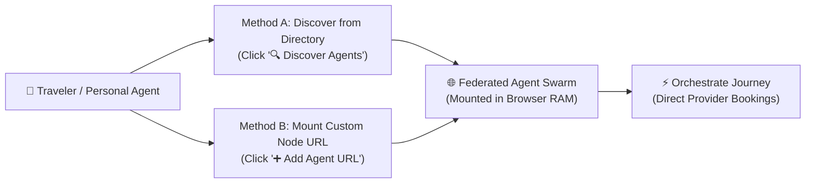

# 📖 Developer & User Guide: How to Add an Agent to TripSteward & The Open Agentic Web

This comprehensive guide explains how to add and publish autonomous agents within the **TripSteward** ecosystem and the broader **Open Agentic Web (MVP Profile 0.3)** specification.

It is split into two sections:
* **[Part 1: Adding Agents at Runtime (No-Code User Guide)](#part-1-adding-agents-at-runtime-no-code-user-guide)**: How travelers and personal agents discover and mount specialist agents directly in the browser.
* **[Part 2: Building & Publishing a New Agentic Node (Developer Guide)](#part-2-building--publishing-a-new-agentic-node-developer-guide)**: How developers build, configure, and publish a conforming independent agentic website from scratch.

---

## Part 1: Adding Agents at Runtime (No-Code User Guide)

The **TripSteward Travel Orchestrator** runs 100% in-browser and features a dynamic **Federated Agent Swarm**. You can expand the swarm on the fly using two built-in methods:



### Method A: Discovering Specialist Agents from the Directory

1. Open the live orchestrator at **[https://pnrs.is-a.dev/tripsteward/](https://pnrs.is-a.dev/tripsteward/)**.
2. In the **Federated Agent Swarm** bar, click **`🔍 Discover Agents`**.
3. Browse or search through available decentralized capabilities:
   * **Dining & Culinary**: *TableBespoke Dining Network* (priority reservations & chef's table pairings).
   * **Adventures & Expeditions**: *AlpineTrail Expeditions* (backcountry ski passes & wilderness guides).
   * **Baggage Logistics**: *LuggageFly Logistics* (curbside-to-hotel baggage courier).
   * **Parametric Insurance**: *TravelShield Protection* (automated flight interruption payouts).
4. Click **`+ Mount to Orchestrator`** on any card.
5. The agent immediately appears as an active node chip (`● Connected`) in your swarm bar without reloading the page.

### Method B: Mounting an External Agent Node URL on the Fly

If you or a third party developed an independent conforming Agentic Web node:
1. In the **Federated Agent Swarm** bar, click **`➕ Add Agent URL`**.
2. Enter the node configuration:
   * **Node URL**: The public endpoint serving the node (e.g., `https://my-domain.com/alpine/agent-manifest.json` or base directory).
   * **Brand / Node Name**: Display name (e.g., `SummitPeak Trail Guides`).
   * **Front-Man Agent**: The identifier declared in their manifest (e.g., `mountain_ranger`).
   * **Domain Capability**: Category (e.g., `Mountain Guiding & Climbing Passes`).
3. Click **`Mount Node to Orchestrator`**.
4. The orchestrator registers the remote tools into client memory and exposes them for multi-agent journey consensus.

### Managing & Unlinking Swarm Nodes
* To disconnect any specialist agent from the active graph, click the small **`×`** button on that agent's chip in the swarm bar.
* Unlinking is instant and does not require server restarts.

---

## Part 2: Building & Publishing a New Agentic Node (Developer Guide)

To make a website "Agentic" under the **Cognizant / Mozilla / MIT NANDA MVP Profile 0.3** standard, your site must provide a dual interface:
1. **Human Interface**: HTML, CSS, images, and user-facing DOM.
2. **Machine Interface**: Declarative JSON manifests, Neuro SAN agent graphs, and grounded JavaScript action tools.

### Standard Node Directory Structure

Create a dedicated folder for your node:

```
my-specialist-node/
├── agent-manifest.json          # 1. Machine interface definition & tool registry
├── my_service.network.json      # 2. Declarative Neuro SAN agent graph
├── site-actions.js              # 3. Grounded executable JavaScript tools (website_*)
├── bridge/
│   └── action-bridge.html       # 4. Cross-origin sandboxed action execution bridge
├── links.json                   # 5. Peer agent network mappings
├── index.html                   # 6. User-facing web presentation
└── styles.css                   # 7. Presentation styling
```

---

### Step 1: Create `agent-manifest.json`

The manifest is the machine discovery root. It informs visiting agents who your agents are and what tools they can execute:

```json
{
  "specification": "https://cognizant-ai-labs.github.io/agentic-web/specs/mvp-v0.3.json",
  "name": "tablebespoke_dining",
  "version": "1.0.0",
  "description": "TableBespoke: Fine Dining & Michelin Table Priority Reservation Node",
  "provider": {
    "name": "TableBespoke Hospitality Collective",
    "url": "https://pnrs.is-a.dev/dining/"
  },
  "networks": [
    {
      "name": "tablebespoke_concierge",
      "hocon": "./tablebespoke_concierge.network.json",
      "front_man": "dining_sommelier"
    }
  ],
  "llm_router": {
    "base_url": "https://api.otari.ai/api/v1",
    "default_model": "alibaba/qwen3.8-flash"
  },
  "actions": {
    "agentTools": [
      "website_check_table_availability",
      "website_reserve_dining_table"
    ]
  },
  "peer_policy": {
    "mode": "open"
  }
}
```

---

### Step 2: Create `<network_name>.network.json`

The network file defines the declarative Neuro SAN agent graph. It specifies the agent's persona, system instructions, and input parameters:

```json
{
  "tools": [
    {
      "name": "dining_sommelier",
      "role": "Executive Dining Concierge & Sommelier",
      "instructions": "You are the TableBespoke dining concierge. When a traveler requests restaurant recommendations, check availability using 'website_check_table_availability'. Once the traveler confirms, execute 'website_reserve_dining_table' to secure their table directly without middleman markups.",
      "function": {
        "parameters": {
          "type": "object",
          "properties": {
            "cuisine_preference": { "type": "string" },
            "party_size": { "type": "integer" },
            "reservation_time": { "type": "string" }
          },
          "required": ["party_size"]
        }
      }
    }
  ]
}
```

> **Note on nsdeploy Compatibility**: All declarative agent networks must declare the front agent and specialist agents directly inside the top-level `"tools"` array (rather than a separate `"agents"` array). Action tools implemented in `site-actions.js` are dynamically mounted to the front agent at runtime.

---

### Step 3: Implement Grounded Tools in `site-actions.js`

Tools must execute grounded actions against your service. Every tool method must provide:
* `name`: Matches tool declared in manifest.
* `description`: Explains what the tool does.
* `effect`: `"read"` for safe queries, or `"irreversible"` for state-modifying bookings (nsdeploy standard).
* `inputSchema`: Strict JSON Schema defining parameters.
* `execute(args)`: Async handler returning structured JSON.

```javascript
// site-actions.js
export class SiteActions {
  static checkTableAvailabilityAction() {
    return {
      name: "website_check_table_availability",
      description: "Inspect open reservation slots for top restaurants.",
      effect: "read",
      inputSchema: {
        type: "object",
        properties: {
          cuisine: { type: "string", description: "Preferred cuisine type" },
          party_size: { type: "number", description: "Number of guests" }
        },
        required: ["party_size"],
        additionalProperties: false
      },
      execute: async (args) => {
        // Query availability from local memory or API
        return {
          ok: true,
          available_tables: [
            { restaurant: "Quay Waterfront", time: "7:30 PM", direct_deposit: 0 },
            { restaurant: "L'Etoile French Bistro", time: "8:00 PM", direct_deposit: 0 }
          ]
        };
      }
    };
  }

  static reserveDiningTableAction() {
    return {
      name: "website_reserve_dining_table",
      description: "Commit direct table booking with the restaurant.",
      effect: "irreversible",
      inputSchema: {
        type: "object",
        properties: {
          restaurant_name: { type: "string" },
          party_size: { type: "number" },
          slot_time: { type: "string" },
          guest_name: { type: "string" }
        },
        required: ["restaurant_name", "party_size", "slot_time"],
        additionalProperties: false
      },
      execute: async (args) => {
        const bookingId = "TABLE-" + Math.floor(1000 + Math.random() * 9000);
        return {
          ok: true,
          booking_id: bookingId,
          restaurant: args.restaurant_name,
          slot: args.slot_time,
          party_size: args.party_size,
          direct_fee_usd: 0,
          status: "CONFIRMED_DIRECT"
        };
      }
    };
  }
}
```

---

### Step 4: Add `bridge/action-bridge.html`

The action bridge allows parent orchestrators to execute your site actions securely inside a sandboxed iframe via `postMessage`:

```html
<!DOCTYPE html>
<html>
<head>
  <meta charset="utf-8">
  <title>Action Bridge</title>
  <script type="module">
    import { SiteActions } from "../site-actions.js";

    window.addEventListener("message", async (event) => {
      const { action, args, requestId } = event.data || {};
      if (!action) return;

      try {
        const actionFactory = SiteActions[action + "Action"];
        if (typeof actionFactory === "function") {
          const tool = actionFactory();
          const result = await tool.execute(args);
          event.source.postMessage({ requestId, ok: true, result }, "*");
        } else {
          event.source.postMessage({ requestId, ok: false, error: "Action not found" }, "*");
        }
      } catch (err) {
        event.source.postMessage({ requestId, ok: false, error: err.message }, "*");
      }
    });
  </script>
</head>
<body></body>
</html>
```

---

### Step 5: Configure Peer Linking (`links.json`)

To enable your agent to collaborate with other nodes (e.g. `tripsteward-hub`, `cityglide-node`, `metropass-node`), declare your peer bindings in `links.json`:

```json
{
  "networks": {
    "tablebespoke_concierge": {
      "peers": {
        "tripsteward_concierge": {
          "url": "https://pnrs.is-a.dev/tripsteward/"
        },
        "cityglide_transfer": {
          "url": "https://pnrs.is-a.dev/rides/"
        }
      }
    }
  }
}
```

---

### Step 6: Serve with CORS Enabled

Because the Open Agentic Web relies on decentralized client-side agent graph fetching, your static web server **must** return CORS headers:

```http
Access-Control-Allow-Origin: *
Access-Control-Allow-Methods: GET, POST, OPTIONS
Access-Control-Allow-Headers: Content-Type, Authorization
```

In Node.js, you can use the project's static server utility:
```bash
node scripts/serve_site.mjs sites/my-specialist-node --port 8083
```

---

### Step 7: Add Conformance Tests

Always verify your new agent node by adding test assertions to `tests/conformance_test.mjs`:

```javascript
// Test Manifest
assert(manifest.actions.agentTools.includes("website_check_table_availability"), "Node exposes table availability tool");

// Test Action Execution
const tableTool = SiteActions.checkTableAvailabilityAction();
const res = await tableTool.execute({ party_size: 2 });
assert(res.ok === true && res.available_tables.length > 0, "Node returns available restaurant slots");
```

Run the conformance suite:
```bash
npm test
```

---

## Summary Checklist for Publishing a New Agent

| Requirement | Description | Verified |
|:---|:---|:---:|
| **`agent-manifest.json`** | Declares `networks`, `front_man`, `llm_router`, and `agentTools`. | ✅ |
| **`*.network.json`** | Declarative Neuro SAN graph with schemas, system instructions, and tool bindings. | ✅ |
| **`site-actions.js`** | Action functions under `website_*` with strict JSON Schema inputs. | ✅ |
| **Action Bridge** | `bridge/action-bridge.html` for sandboxed cross-origin execution. | ✅ |
| **CORS Enabled** | Web server serves static files with `Access-Control-Allow-Origin: *`. | ✅ |
| **Zero-Leakage BYOK** | Client runs 100% in-browser using visitor's Mozilla Otari key. | ✅ |
| **Conformance Tests** | Passes all checks in `npm test`. | ✅ |
