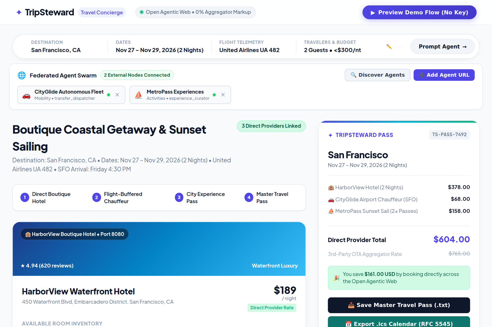
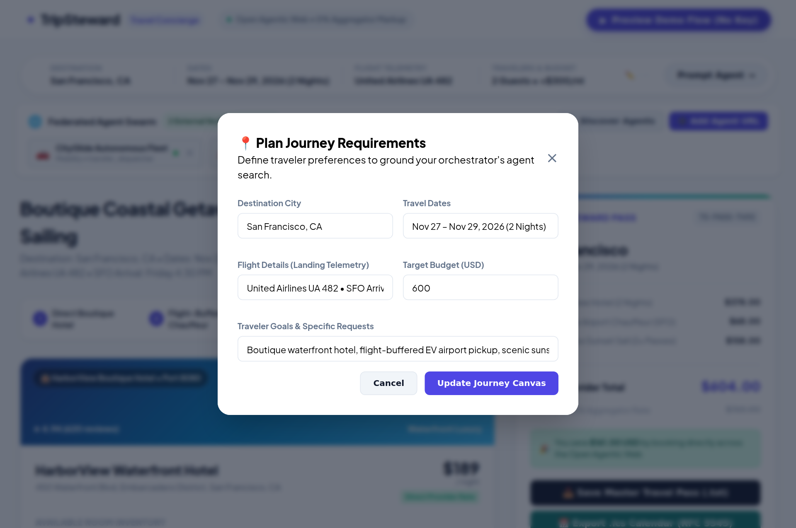
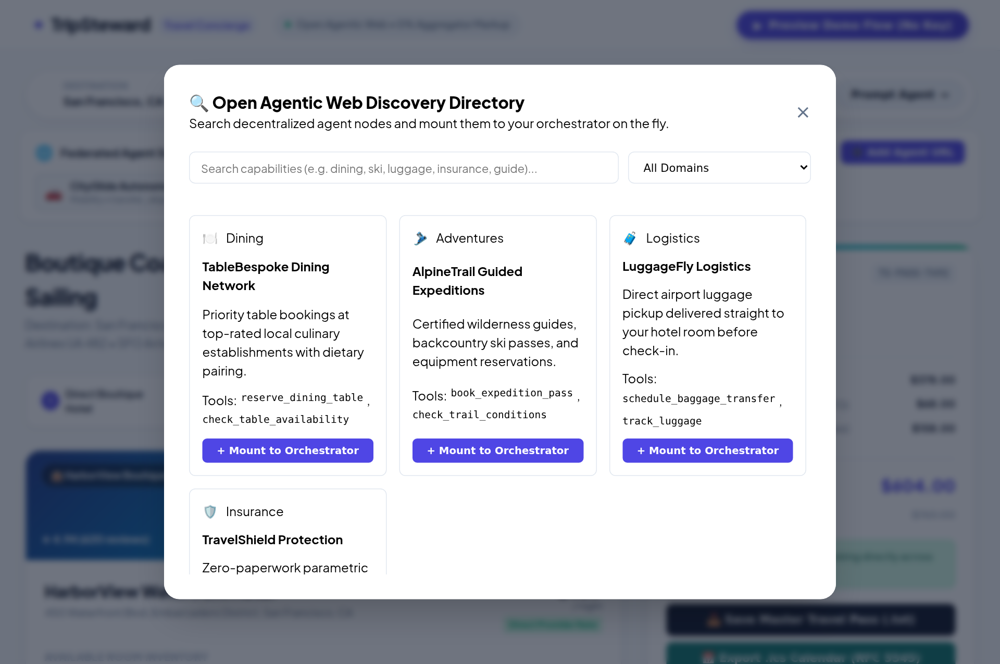
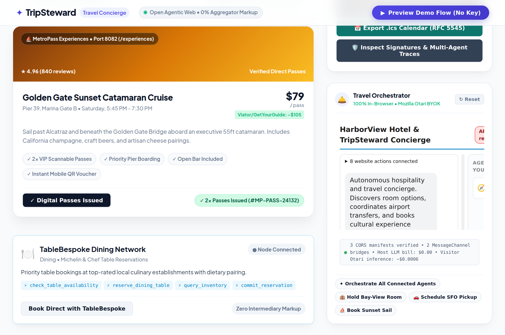
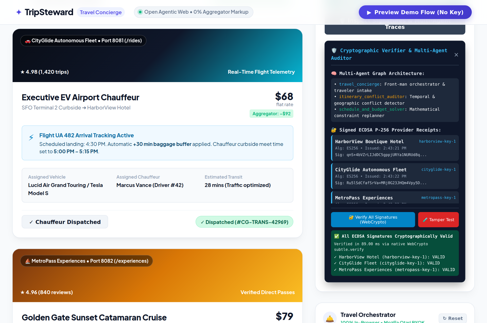
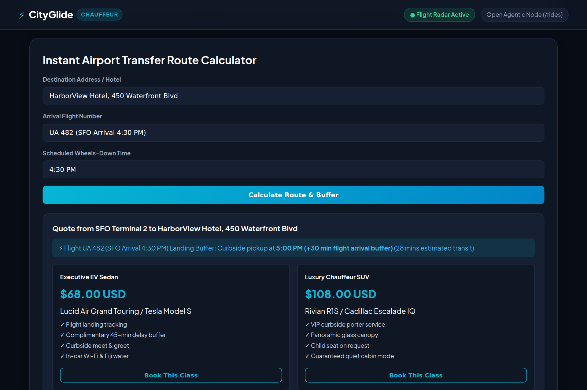
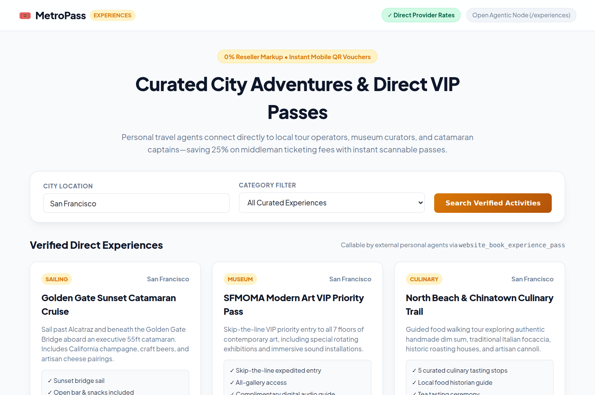
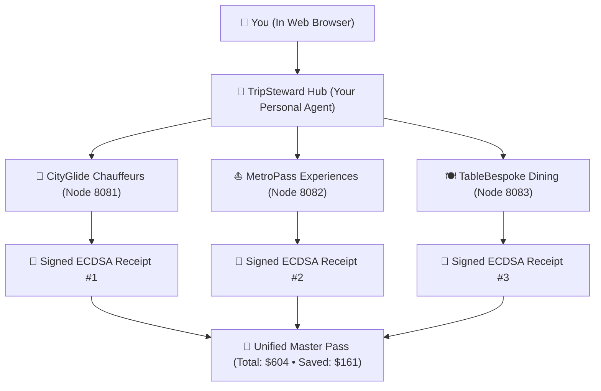

# 🧭 The Kid's & Explorer's Guide to TripSteward: Your Autonomous Travel Robot Team! (ELI12)

Welcome, explorer! Imagine you want to plan a dream vacation to San Francisco, Seattle, or Austin. 

Normally, when grown-ups book a hotel, a car from the airport, and museum passes, they have to visit five different websites, pay expensive middleman fees (often \$142 or more per trip!), and type their name and credit card over and over.

**TripSteward changes everything.** 

Instead of middlemen, you have your own personal **team of friendly AI robot helpers** that live right inside your web browser. They talk directly to the hotel's robot, the chauffeur's robot, and the tour guide's robot to book everything for you in seconds—all while keeping your private information 100% safe!

Here is your easy, step-by-step comic-book style walkthrough of how to use and run TripSteward, with real pictures of every step!

---

## ⚡ Super-Quick Start: The 2 Ways to Play

You can explore TripSteward right now in two ways:

1. **The Live Online Cloud Version (No setup needed!):**
   - 🏨 **TripSteward Concierge Hub:** [https://pnrs.is-a.dev/tripsteward/](https://pnrs.is-a.dev/tripsteward/)
   - 🚗 **CityGlide Airport Chauffeur Node:** [https://pnrs.is-a.dev/rides/](https://pnrs.is-a.dev/rides/)
   - ⛵ **MetroPass Experiences Node:** [https://pnrs.is-a.dev/experiences/](https://pnrs.is-a.dev/experiences/)

2. **The Local Hacker Version (Running on your computer):**
   ```bash
   git clone https://github.com/Elroi-thecreator/tripsteward-agentic-travel.git
   cd tripsteward-agentic-travel
   npm install
   npm start
   ```
   *Then open `http://localhost:8080` in your web browser!*

---

## 🗺️ Step-by-Step Guided Tour (With Screenshots)

---

### Step 1: Meet the TripSteward Concierge Hub

When you first open TripSteward, you will see a clean, modern dashboard that looks like a futuristic travel app. 



#### What are you looking at?
- **The Top Capsule Bar:** Shows your current destination (San Francisco, CA), travel dates (Nov 27 – Nov 29), incoming flight (UA 482 arriving at 4:30 PM), and your budget goal.
- **The 3 Partner Cards in the Middle:**
  1. 🏨 **HarborView Waterfront Hotel** (Boutique luxury room for \$189/night)
  2. 🚗 **Executive EV Chauffeur** (Lucid Air EV sedan for \$68 flat rate)
  3. ⛵ **Golden Gate Sunset Catamaran Cruise** (VIP catamaran passes for \$79/person)
- **The Autonomous Concierge Chat on the Right:** Your personal AI travel agent waiting for your orders.

> [!TIP]
> **ELI12 Super-Fact:** Notice that little green pill that says **"Client-Side Zero-Leakage Privacy"**? That means your name, travel dates, and hotel choices never leave your computer's memory! The static web servers receive 0 bytes of your personal data.

---

### Step 2: Customize Your Journey Requirements

Want to change your flight number, switch your city, or set a special budget? Click the **✏️ Edit** button inside the top search capsule!



#### What to do:
1. Click **✏️ Edit** in the top capsule.
2. A sleek dialog pops up where you can type your Destination City, Travel Dates, Flight Number (e.g. `UA 482 Landing at 4:30 PM`), and your maximum spending budget.
3. Click **"Update Journey Canvas"**.
4. The entire board instantly recalibrates to your new travel goals!

---

### Step 3: Discover & Mount New Specialist Robots

What if you also want a fine-dining dinner table, mountain hiking guides, or airport luggage delivery? You don't need to install any apps or sign up for new websites!

Click the **🔍 Discover Agents** button at the top of the Connected Agents list:



#### What's happening here?
- This is the **Open Agentic Web Directory**. It is like an app store, but for decentralized AI robots!
- You can type **"Dining"**, **"Adventures"**, or **"Logistics"** to find specialist agents like:
  - 🍽️ **TableBespoke Dining Concierge**
  - 🏔️ **AlpineTrail Expedition Guide**
  - 🧳 **LuggageFly Airport Courier**
  - 🛡️ **TravelShield Parametric Insurance**
- Click **"+ Mount to Orchestrator"** on any card.
- Instantly, that agent joins your personal travel robot team, and a brand-new card appears directly in your dashboard!

---

### Step 4: Book Directly with Zero Middleman Fees

Now comes the fun part: making your reservations! You can do this in two ways:
- **Option A (Manual 1-Click):** Click the direct booking button on any provider card:
  - Click **"Hold Room Directly (\$189/nt)"** on the hotel card.
  - Click **"Dispatch Airport Chauffeur (\$68)"** on the transfer card.
  - Click **"Issue 2x Passes (\$158.00)"** on the experience card.
- **Option B (Autonomous Full-Auto):** Click the shiny blue button at the top right: **"▶ Run Autonomous Simulation"** or click the chip **"✦ Orchestrate All Connected Agents"**.



#### Look at what happens!
- The status pills turn green:
  - 🏨 **✓ Reserved (#HV-STAY-...)**
  - 🚗 **✓ Dispatched (#CG-TRANS-...)**
  - ⛵ **✓ 2x Passes Issued (#MP-PASS-...)**
- **The Flight Delay Buffer Magic:** Notice how your plane lands at 4:30 PM, but CityGlide automatically schedules your pickup for **5:00 PM**? That is because the flight tracking agent knows humans need about 30 minutes to pick up their bags from baggage carousel 4! It protects you from missing your ride.

---

### Step 5: Check the Cryptographic Wax Seals (WebCrypto Inspector)

In the old days, kings and queens would seal secret letters with a stamped wax seal so nobody could change the message. 

TripSteward does the exact same thing, but with modern math called **ECDSA P-256 Digital Signatures**!

Click the **🛡️ Inspect Signatures & Multi-Agent Traces** button near the bottom:


#### Try the Tamper Test!
1. Click **"🔐 Verify All Signatures (WebCrypto)"**. You will see:
   `✅ All ECDSA Signatures Cryptographically Valid` (verified in ~1.5 milliseconds).
2. Now, click **"🧪 Tamper Test"**!
3. The app simulates a bad guy sneaking into your browser's memory and changing the hotel bill to \$9.99.
4. **BAM!** The verifier immediately flashes red:
   `❌ Cryptographic Verification Failed (Tamper Caught!)`
   Because the digital signature no longer matches the altered message, the fraud is caught instantly!

---

### Step 6: Get Your Master Travel Pass & Calendar

Once your reservations are confirmed, your personal travel pass is automatically generated:



#### Features:
- **Instant Digital Pass:** Displays your unique reference code (e.g. `TS-PASS-7492`) with a scannable QR code.
- **Save as Text File:** Click **"📥 Save Master Travel Pass (.txt)"** to download your complete itinerary receipt.
- **Export to Calendar:** Click **"📅 Export .ics Calendar"** to generate an industry-standard RFC 5545 calendar file that syncs directly into Apple Calendar, Google Calendar, or Microsoft Outlook!

---

### Step 7: Peek Inside the Chauffeur Fleet Station (CityGlide)

Remember how we said each website has its own independent robot? Let's go visit CityGlide's station directly at [https://pnrs.is-a.dev/rides/](https://pnrs.is-a.dev/rides/) (or `http://localhost:8081`):



Here, you can:
- See all available electric cars (Lucid Air Grand Touring, Tesla Model S, Rivian R1S).
- Use the **Instant Route & Buffer Calculator** to calculate flight delay buffers.
- Watch the **Live Confirmed Dispatch Manifest** update in real-time as agents book rides across the city!

---

### Step 8: Peek Inside the Experience Hall (MetroPass)

Now let's visit the city experience provider at [https://pnrs.is-a.dev/experiences/](https://pnrs.is-a.dev/experiences/) (or `http://localhost:8082`):



Here, you can:
- Search through verified adventures (Sunset Catamaran Cruises, SFMOMA VIP Passes, North Beach Culinary Trails).
- Check live issued pass vouchers with instant admission barcodes.
- See how external personal agents interact with the site's declared action tools (`website_search_experiences` and `website_book_experience_pass`).

---

## 🤖 The Secret Behind the Magic: How Does It Actually Work?

If you were explaining this to your friends in 6th grade, here are the 4 big ideas to remember:



1. **Declarative Networks (`*.network.json`):** Instead of writing thousands of lines of complicated server code, each website simply publishes a declarative blueprint describing who its robot is and what tools it can use.
2. **Bring Your Own Key (BYOK):** The websites don't pay anything for the AI. You bring your own free key (like Mozilla Otari or OpenRouter) stored securely in your browser's private memory.
3. **Cross-Origin Action Bridges:** When TripSteward wants to book a catamaran on MetroPass, it uses secure browser `postMessage` communication. It never peeks at passwords or private cookies.
4. **Digital Signatures (Non-Repudiation):** When a booking is made, the provider stamps it with their private cryptographic key. When you show up at the hotel, they can verify your receipt with 100% mathematical certainty—no fake tickets possible!

---

## 🧪 How to Run Automated Robot Tests Yourself

Want to prove everything works with zero errors? Open your terminal and run:

```bash
# 1. Run the 127-point protocol conformance test
npm test

# 2. Run the Playwright real-browser robot clicker test
npm run test:e2e

# 3. Run the test against the live production internet server!
npm run test:e2e:live
```

You'll see all 38 browser button checks pass with shiny green checkmarks!

---

**Happy exploring on the Open Agentic Web! 🚀**
